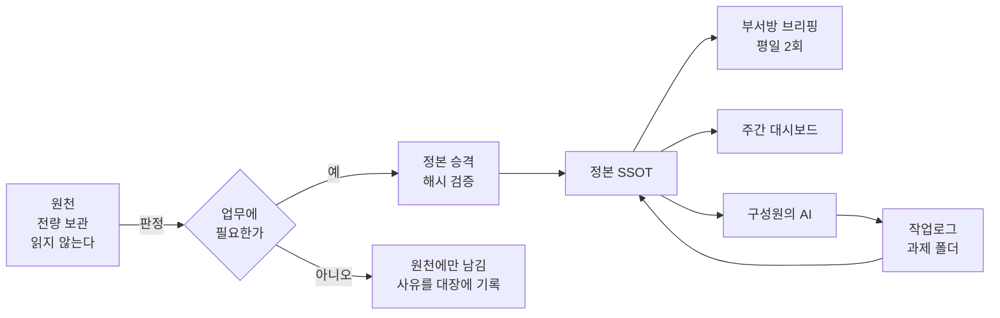
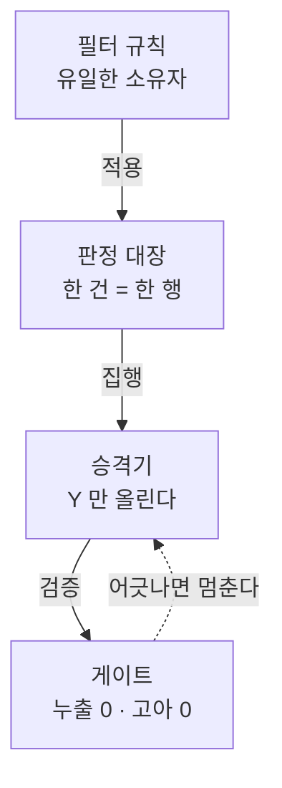

# UR Harness

**조직의 AX 하네스.** 이미 쓰고 있는 협업 도구를 하나도 바꾸지 않고, 그 위에 데이터 인프라를 올려
구성원 전원이 같은 정본을 보고 실시간으로 확인하며 일하게 만듭니다.

그리고 **AI 가 모르면서 아는 척하는 것을 멈추게** 합니다.

```
설치 0 · 신규 학습 0 · 구성원 시작까지 3단계 16분
```

---

## 목차

[무엇인가](#무엇인가) · [왜 필요한가](#왜-필요한가) · [할 수 있게 되는 것](#할-수-있게-되는-것) ·
[구조](#구조) · [빠른 시작](#빠른-시작) · [구성 요소](#구성-요소) · [서비스](#상시-서비스) ·
[설계 원칙](#설계-원칙) · [고장과 장치](#고장에서-장치로) · [문서](#문서) · [이관](#담당자-이관) · [보안](#보안)

---

## 무엇인가

세 층을 쌓습니다. **아래 두 층은 조직이 이미 가진 것이고, 위 두 층을 이 저장소가 제공합니다.**

```mermaid
graph TB
    subgraph L0["기존 DX 환경 — 교체하지 않습니다"]
        A1["그룹웨어<br/>메일·캘린더·메신저·조직도"]
        A2["클라우드 드라이브<br/>원천 자료"]
        A3["사내 위키"]
    end
    subgraph L1["AX 전사 계층 — 새로 도입"]
        B1["온라인 회의 전사"]
        B2["대면 녹음 전사"]
    end
    subgraph L2["AX_Infra — 이 저장소"]
        C1["자동 서비스 17개<br/>수집 · 정제 · 판정 · 승격 · 색인 · 감시"]
    end
    subgraph L3["정본 SSOT — 전원 접근"]
        D1["계약<br/>규약·구역표·온보딩"]
        D2["스킬 5종"]
        D3["정본 데이터"]
        D4["관측·게이트"]
    end
    E["구성원의 AI<br/>Windows · macOS · Linux"]

    A1 --> C1
    A2 --> C1
    A3 --> C1
    B1 --> C1
    B2 --> C1
    C1 -->|"업무에 필요한 것만<br/>해시 검증"| D3
    D1 --> E
    D2 --> E
    D3 --> E
    D4 --> E
```



> **기존 도구는 API 로 읽기만 합니다.** 원천을 바꾸지 않으므로 도입 저항이 없고,
> 구성원은 쓰던 방식 그대로 일합니다.

---

## 왜 필요한가

AI 를 도입한 조직이 공통으로 겪는 네 가지입니다.

| 증상 | 실제로 일어나는 일 |
|---|---|
| AI 가 "자료가 없다"고 한다 | 있는데 못 찾습니다. 전부 보지 않고 중간에 결론을 냅니다 |
| 같은 질문에 사람마다 다른 답 | 각자의 AI 가 **서로 다른 사실**을 믿고 있습니다 |
| 어제 올린 파일이 안 보인다 | 동기화 캐시가 조용히 뒤처져도 알려주지 않습니다 |
| 회의 결정이 기록에 없다 | 사람 기억에만 남습니다 |

> **공통 원인은 하나입니다. 사람이든 기계든 세상의 상태를 틀리게 알고 있었고, 그것을 모른 채 일했습니다.**

---

## 할 수 있게 되는 것

| | | 어떻게 |
|---|---|---|
| **01** | 찾으면 나온다 | 메일·문서·회의록·일정이 과제별로 한 곳에. 업무 무관 자료는 **애초에 들어오지 않습니다** |
| **02** | 전원이 같은 걸 본다 | 새 자료는 **최대 90분** 안에 모두에게 반영됩니다 |
| **03** | 회의가 저절로 남는다 | 녹음 파일 하나로 회의록 초안까지. 1시간 회의가 약 1분 |
| **04** | 모르면 모른다고 한다 | 「없다」고 하려면 **탐색 보고**를 먼저 냅니다 |
| **05** | 반복이 도구가 된다 | 자주 하는 일을 스킬로. **전원이 같은 방식으로** |

---

## 구조

### 데이터 흐름



**원천은 전량 보관하되 읽지 않습니다.** 다 읽으면 수백만 토큰이 들기 때문입니다.
정본에는 업무에 필요한 것만 올리고, **왜 걸러졌는지는 판정 대장에 한 줄씩 남습니다.**

### 판정 분리 — 가장 이식 가능한 패턴



효과는 **검증 가능성**입니다. "이 자료가 왜 정본에 없는가"에 표 한 장을 검색해서 답합니다.
원천을 다 읽으면 수백만 토큰인 질문이 사실상 0 토큰이 됩니다.

### 실시간성 — 주기로 정의합니다

| 무엇 | 주기 |
|---|---|
| **이상 감지** | **15분** |
| **정본 승격** | **30분** |
| 메일·캘린더·메신저 수집 | 60분 |
| 원천 변경 추적 | 120분 |
| 검색 색인 재생성 | 180분 |
| 부서방 브리핑 | 평일 08:00 · 17:00 |

```
새 자료 도착 → 최대 60분 → 정제·판정 → 최대 30분 → 전원이 본다 = 최대 90분
이상이 생기면 15분 안에 보고된다
```

> **지연을 숨기지 않는 것**이 설계의 일부입니다. 각 구성원의 AI 는 작업 전에 신선도를 읽고,
> 자기가 보는 자료가 얼마나 오래됐는지 **먼저 보고한 뒤** 일합니다.

---

## 빠른 시작

### 관리자 (서버 1대)

```bash
git clone https://github.com/<owner>/ur-harness.git && cd ur-harness

bash install/bootstrap.sh                        # 1. 점검 + 의존성
cp config/harness.example.yaml config/harness.yaml
$EDITOR config/harness.yaml                      # 2. 값 입력
python3 install/configure.py --all               # 3. 치환 + 서비스 유닛 생성
# configure 가 출력한 systemd 명령을 실행
python3 core/gate_check.py                       # 4. 정합성 확인
```

요구 사항: **Ubuntu 22.04+** · Python 3.10+ · rclone.
선택: node(다이어그램) · ffmpeg(녹음 전사) · cloudflared(봇 수신).

### 구성원 (설치 없음)

```
1. 공유 드라이브에 접근한다            5분
2. 그 폴더에서 AI 클라이언트를 연다     1분   ← 진입점이 자동으로 읽힌다
3. 온보딩이 스스로 돈다                10분
```

3단계에서 AI 가 OS·경로·런타임을 **묻지 않고 직접 확인**하고, 다섯 가지만 물어 개인 지침을 만듭니다.

---

## 구성 요소

```
ur-harness/
├─ core/            운영 코어 — 승격 · 색인 · 감시 · 게이트 · 원장 · 명부
├─ agents/
│  ├─ nworks/       그룹웨어 수집 · 정제 · 판정 · 브리핑 · 봇 중계
│  ├─ fathom/       회의 전사 수집 → 회의록
│  ├─ budget/       예산 원장 동기화
│  ├─ dashboard/    주간 대시보드 생성·게시
│  └─ manuals/      시스템 매뉴얼 빌드
├─ shared/rpbd/     공용 패키지 — 분류 · 수집 · 뷰모델
├─ tasks/           과제 태스크 · 원장 · 산출물 점검
├─ skills/          스킬 5종 (전원 사용)
├─ ssot-template/   정본 폴더 구조 뼈대 + 규범 템플릿
├─ install/         bootstrap · configure · 서비스 정의
├─ config/          설정 예시
├─ docs/            온보딩 · 운영 · 보안
└─ scan.py          공개 전 익명화·비밀값 게이트
```

| | 파일 | 행 |
|---|---|---|
| 코드 | 180+ | 약 27,000 |
| 문서 | 15+ | 약 1,100 |

---

## 상시 서비스

`install/services.yaml` 하나가 **OS 중립 정의**이고, 거기서 systemd(Linux) · launchd(macOS) ·
작업 스케줄러(Windows) 를 생성합니다.

| 서비스 | 하는 일 | 주기 |
|---|---|---|
| `nworks-cycle` | 그룹웨어 수집 → 파싱 → 판정 → 동기화 | 60분 |
| `ssot-promote` | 정본 승격 (해시 검증) | 30분 |
| `ssot-index` | 색인 재생성 (신선도 가드) | 180분 |
| `watchdog` | 신선도 · 정지 · 중복 감시 | 15분 |
| `gate-check` | 계약 정합성 게이트 | 6시간 |
| `daily-brief` | 부서방 브리핑 | 평일 2회 |
| `weekly-dashboard` | 주간 대시보드 | 주 1회 |
| `roster-sync` · `hr-sync-check` | 조직도 → 온톨로지 | 주 1회 |
| `fathom-minutes` | 회의 전사 수집 | 주 1회 |
| `source-changefeed` | 원천 변경 추적 | 120분 |
| `log-rotate` | 로그 회전 | 6시간 |

선택(기본 꺼짐): `agent-bridge` · `tunnel-guard` · `ops-ledger` · `budget-sync` · `mount-resync`

```bash
python3 install/configure.py --with agent-bridge --units    # 선택 서비스 켜기
```

---

## 설계 원칙

### 성숙도는 "거짓 확신이 얼마나 빨리 들키는가"로 잽니다


이 하네스의 목표는 **D3** 입니다. 틀린 믿음을 없애는 것이 아니라, 틀린 믿음으로 결론을 내기 전에 멈추는 것입니다.

### 다섯 가지 원칙

| | 원칙 | 왜 |
|---|---|---|
| ① | **도구를 전제하지 않는다** | 구성원마다 환경이 다릅니다. 설치를 조건으로 걸면 일부에게 성립하지 않습니다 |
| ② | **판정을 데이터로 분리한다** | 규칙을 코드에 심으면 검증할 수 없습니다 |
| ③ | **틀린 확신을 멈추게 한다** | 낡은 자료로 내린 결론은 틀린 줄도 모르고 퍼집니다 |
| ④ | **조용히 물러나지 않는다** | 「확인 불가」와 「통과」는 다른 보고입니다 |
| ⑤ | **이식되는 것과 기기에 묶인 것을 가른다** | 섞이면 기기를 바꿀 때 개인 설정까지 날아갑니다 |

### 쓰기 주체는 경로마다 하나

| 구역 | 누가 씁니다 |
|---|---|
| 과제 폴더 · 회의록 · 부서정본 | 사람(의 AI) |
| 메일 · 메신저 · 캘린더 · 대시보드 · `_시스템/` | 자동화만 |

섞으면 동기화가 충돌하고 사본이 생깁니다. 자동화가 사람 구역에 쓰려 하면 **거부합니다.**

---

## 고장에서 장치로

실제로 난 사고와, 각각을 다시 잡는 장치입니다. **이 목록이 가장 이식 가능한 자산입니다.**

| # | 고장 | 지금 막는 것 |
|---|---|---|
| 1 | 자동화가 구성원 파일 7건을 지웠다 | 동기화 명령을 `sync`→`copy` 로 · 쓰기 구역표 |
| 2 | 클라우드 자리표시자에 추기 → 원문 유실 | 한 파일에 API·마운트 혼용 금지 |
| 3 | 캐시가 8일 뒤처진 채 결론을 냈다 | 신선도 지표 + 15분 감시 |
| 4 | 폐지된 폴더를 보고 "진전 없음"으로 오판 | 경로 리터럴 가드 · 최신 파일 시각 먼저 |
| 5 | 삭제 후 재색인 누락 → 색인 유령 446행 | 삭제-재색인을 한 묶음으로 |
| 6 | 캐시가 465건 뒤처진 채 색인을 덮었다 | **신선도 가드** (원격↔로컬 대조 후 중단) |
| 7 | 업로드 대기분이 캐시 초기화로 사라질 뻔 | **사전 백업** (실제로 작업물 2건 구조) |
| 8 | **폴백이 가드를 조용히 껐다** | 「작동 불가」와 「통과」를 구별해 보고 |

**6·7번 장치는 만든 당일 실제로 작동했습니다.**
8번이 가장 비쌌습니다 — 가드가 도구를 못 찾자 "통과"로 처리해 자동 실행에서 **항상 꺼져 있었고**,
자료 475건이 색인에서 사라졌습니다.

---

## 문서

| | 무엇 | 누구에게 |
|---|---|---|
| [00 이관 체크리스트](docs/00_이관_체크리스트.md) | 담당자 변경 · 서버 이전 | 인계하는/받는 사람 |
| [01 관리자 온보딩](docs/01_관리자_온보딩.md) | 설치 · 운영 · 유지보수 | 관리자 |
| [02 사용자 온보딩](docs/02_사용자_온보딩.md) | 시작하기 · 쓰는 법 | 전 구성원 |
| [03 봇·게이트웨이 연동](docs/03_봇_게이트웨이_연동.md) | 메신저 발신·수신 · 전사 연동 | 관리자 |
| [04 정본 구조와 규범](docs/04_SSOT_구조와_규범.md) | 폴더 구조 · 네 가지 규범 | 전 구성원 |
| [05 업무 매뉴얼](docs/05_업무_매뉴얼.md) | 사업계획서 · 예산 · 회의록 · 주간보고 | 전 구성원 |
| [06 운영과 장애 대응](docs/06_운영과_장애대응.md) | 증상별 대응 · 백업 | 관리자 |
| [07 보안](docs/07_보안.md) | 비밀값 · 데이터 취급 · 권한 | 관리자 |
| [스킬 가이드](skills/README.md) | OS 별 설치 · 능력 선언 | 전 구성원 |
| [정본 템플릿](ssot-template/README.md) | 폴더 구조 복사해 시작 | 관리자 |

---

## 담당자 이관


**조직 자산(공유 드라이브 · 봇 · 서비스 계정)은 그대로 씁니다.** 조직 소유지 개인 것이 아닙니다.
실제로 다시 해야 하는 것은 **개인 계정에 묶인 인증 2건**뿐입니다.

| | 바뀌나 |
|---|---|
| 공유 드라이브 · 봇 · 서비스 계정 · 채널 ID | **그대로** |
| 개인 Google 계정 (드라이브 OAuth) | **바뀜** |
| 그룹웨어 메일 동의 (사용자 계정 전용 API) | **바뀜** |
| 작업 디렉토리 경로 | **바뀜** |

자세한 절차와 검증은 [00 이관 체크리스트](docs/00_이관_체크리스트.md).

---

## 보안

**비밀값은 이 저장소에 없습니다.** 코드는 자리표시자(`{{TOKEN}}`)를 담고,
`configure` 가 설정을 읽어 `build/` 에 실행본을 만듭니다. 설정과 빌드는 모두 커밋되지 않습니다.

```bash
python3 scan.py .          # 공개 전 게이트 — 0건이어야 올립니다
```

| 잡는 것 | |
|---|---|
| 개인 식별자 | 사람 이름 · 개인 계정 · 조직 고유명 (목록은 `scan.local.json`, 커밋하지 않음) |
| 환경 고유값 | 개인 홈 경로 · 드라이브 ID |
| 비밀값 | API 키 접두 · PEM 블록 · 토큰 리터럴 |
| 연락처 | 이메일 · 전화번호 |

`# scan:allow` 주석과 `example.org` · `<자리표시자>` 는 통과시킵니다.
**한 번 공개된 것은 지워도 캐시와 포크에 남습니다** — 커밋 전에 거르는 것이 유일한 방법입니다.

자세한 것은 [07 보안](docs/07_보안.md).

---

## 이 하네스가 증명하는 것

"자동화를 많이 했다"가 아닙니다.

| 주장 | 증거 |
|---|---|
| **규약이 작성자 밖에서 작동한다** | 런타임이 없는 환경의 구성원이 작업로그 38건을 남겼습니다. 설치 절차 없이, 설계자의 도구 없이 |
| **판정을 데이터로 분리하면 검증된다** | 판정 대장 1,533행 → 게이트 **12/12 통과** (누출 0 · 고아 0) |
| **고장을 장치로 바꿨다** | 실제 사고 8건 → 각각에 가드 1개. 그중 둘은 **만든 당일 작동** |
| **틀린 확신을 멈추는 것이 핵심이다** | 신선도 가드가 원격 9,454 / 로컬 8,887 불일치를 감지해 색인 갱신을 중단 |

---

## 라이선스

[MIT](LICENSE)
