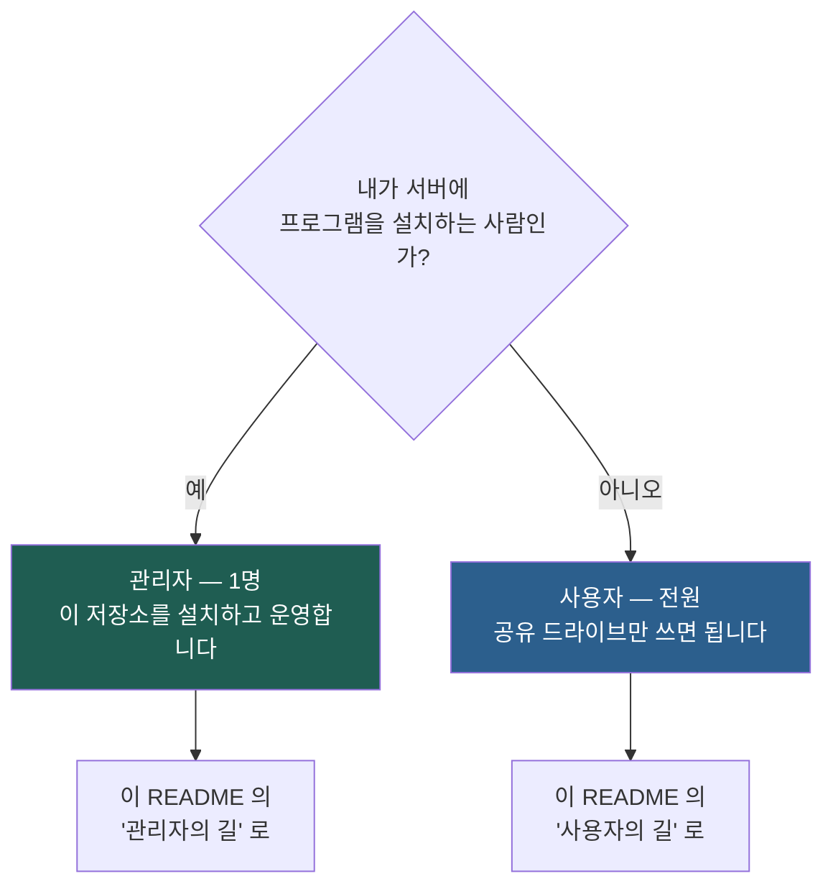
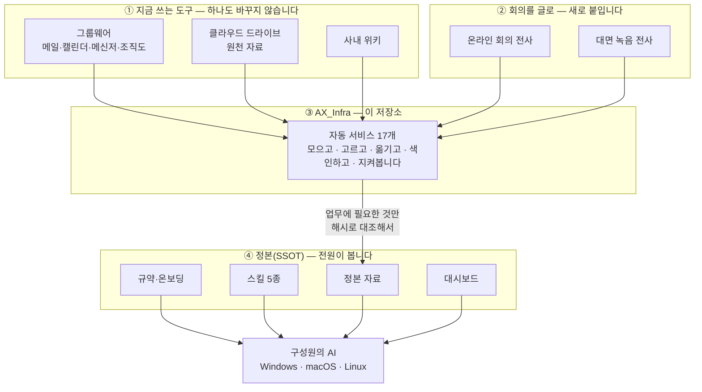
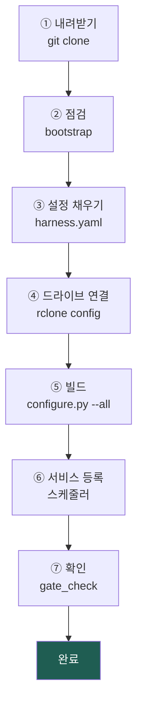
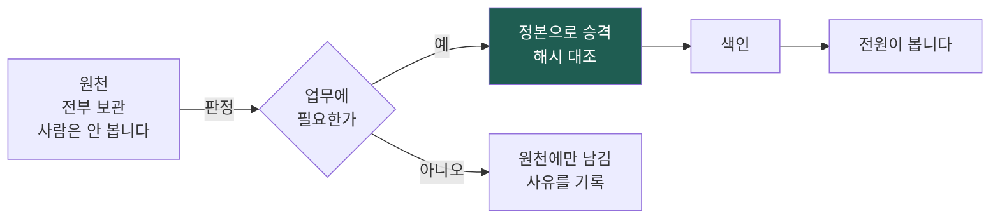

# UR Harness

**조직의 AX 하네스.** 지금 쓰고 있는 협업 도구를 하나도 바꾸지 않고, 그 위에 데이터 인프라를 올려
**구성원 전원이 같은 자료를 보고 일하게** 만듭니다.

```
구성원은 설치할 것이 없습니다 · 새로 배울 것이 없습니다 · 시작까지 3단계 16분
```

---

## 먼저 — 나는 관리자인가, 사용자인가?

이 저장소를 보는 사람은 둘 중 하나입니다. **역할에 따라 할 일이 완전히 다릅니다.**



### 한 줄로 가르면

| | 관리자 | 사용자 |
|---|---|---|
| **몇 명** | 조직에 **1명** (대개 AX 담당자) | **나머지 전원** |
| **이 저장소를** | 서버에 내려받아 설치합니다 | **내려받지 않습니다** |
| **설치할 프로그램** | Python · git · rclone 등 | **없음** |
| **만지는 것** | 서버 · 설정 파일 · 자동 서비스 | 공유 드라이브 폴더 하나 |
| **걸리는 시간** | 처음 1~2시간, 이후 월 10분 | **16분**, 이후 그냥 씀 |
| **기술 지식** | 터미널을 쓸 줄 알면 충분 | **필요 없음** |
| **읽을 문서** | 01 · 03 · 06 · 07 · 09 | **02 하나** |

> **헷갈리면 사용자입니다.** 조직에 관리자는 한 명뿐이고,
> 본인이 관리자라면 이미 그렇게 지정받았을 것입니다.

---

## 목차

**사용자** → [사용자의 길](#사용자의-길) · [무엇이 좋아지나](#무엇이-좋아지나) · [스킬](#스킬--자주-하는-일을-도구로)
**관리자** → [관리자의 길](#관리자의-길) · [설치 7단계](#설치--일곱-단계) · [서비스](#자동-서비스-17개) · [담당자 이관](#담당자-이관)
**공통** → [무엇인가](#무엇인가) · [구조](#구조) · [설계 원칙](#설계-원칙) · [문서](#문서) · [보안](#보안)

---

## 무엇인가

네 개 층을 쌓습니다. **아래 두 층은 조직이 이미 가진 것이고, 위 두 층을 이 저장소가 올립니다.**



> **기존 도구에서는 읽기만 합니다.** 원천을 건드리지 않으니 도입 저항이 없고,
> 구성원은 쓰던 방식 그대로 일합니다.

### 쉽게 말하면

도서관을 하나 짓는 일입니다.

| 비유 | 실제 |
|---|---|
| 여기저기 흩어진 책 | 메일·드라이브·위키·회의 녹음에 흩어진 자료 |
| 사서가 모아서 분류 | 자동 서비스 17개가 모으고 업무용만 골라냅니다 |
| 서가에 꽂고 목록을 만든다 | 과제별 폴더에 놓고 색인을 만듭니다 |
| 누구나 같은 서가를 본다 | 전원이 같은 공유 드라이브를 봅니다 |
| 사서가 매일 서가를 점검 | 감시 서비스가 15분마다 확인합니다 |

**관리자는 도서관을 짓는 사람이고, 사용자는 책을 빌리는 사람입니다.**

---

# 사용자의 길

> 이 장만 읽으면 됩니다. 아래 「관리자의 길」은 보지 않아도 괜찮습니다.

## 시작하기 — 세 단계, 16분


### 1단계 · 접근 권한 받기 (5분)

관리자에게 **공유 드라이브 접근 권한**을 요청합니다. 그게 전부입니다.
권한이 들어오면 내 컴퓨터의 드라이브 목록에 그 폴더가 보입니다.

### 2단계 · 그 폴더에서 AI 열기 (1분)

| 쓰는 방식 | 방법 |
|---|---|
| 데스크톱 앱 | Code 탭 → **그 폴더 열기** |
| 터미널 | 그 폴더로 이동한 뒤 실행 |

폴더를 열면 **진입점 파일이 자동으로 읽힙니다.** 나머지는 AI가 알아서 가져옵니다.
설치도, 설정도, 명령어 외우기도 없습니다.

### 3단계 · 질문 다섯 개 (10분)

AI가 묻습니다.

```
1. 누구십니까                      이름
2. 직책과 주로 하는 일은            예: 연구기획, 사업계획서 작성
3. 맡은 과제는                     예: AI바우처, 팁스
4. 어떤 도구를 쓰십니까              예: 엑셀, 한글
5. 답변은 어떤 형식이 편하십니까       예: 표로, 짧게
```

> **OS·설치된 프로그램·폴더 경로는 묻지 않습니다.** AI가 직접 확인합니다.

끝나면 바로 일할 수 있습니다.

## 내 설정은 세 칸으로 나뉩니다

```
[조직 공통]   정본 위치 · 규약          ← 온보딩이 만들고 알아서 갱신합니다
[내 환경]     OS · 쓰는 프로그램         ← 컴퓨터를 바꾸면 버리고 다시 만듭니다
[나의 방식]   답변 형식 · 확인 습관       ← 내 것. 컴퓨터를 바꿔도 따라옵니다
```

> 섞어 두지 마십시오. 섞으면 컴퓨터를 바꿀 때 「나의 방식」까지 같이 날아갑니다.

## 무엇이 좋아지나

| | 무엇 | 어떻게 |
|---|---|---|
| **01** | **찾으면 나옵니다** | 메일·문서·회의록·일정이 과제별로 한 곳에. 업무와 무관한 자료는 **애초에 들어오지 않습니다** |
| **02** | **전원이 같은 걸 봅니다** | 새 자료는 **최대 90분** 안에 모두에게 반영됩니다 |
| **03** | **회의가 저절로 남습니다** | 녹음 파일 하나로 회의록 초안까지. 1시간 회의가 약 1분 |
| **04** | **모르면 모른다고 합니다** | AI가 「없다」고 하려면 어디를 어떻게 찾았는지 **탐색 보고**를 먼저 냅니다 |
| **05** | **반복이 도구가 됩니다** | 자주 하는 일을 스킬로. **전원이 같은 방식으로** 합니다 |

## 스킬 — 자주 하는 일을 도구로

스킬은 **AI에게 주는 작업 설명서**입니다. 이름만 부르면 그 절차대로 일합니다.
**다섯 개 모두 전원이 쓸 수 있습니다.**

| 스킬 | 무엇을 합니까 | 언제 씁니까 |
|---|---|---|
| **works** | 과제 작업을 시작합니다. 신규인지 기존인지 묻고, 기존이면 **어디까지 진행됐는지 복귀 브리핑**을 만들어 줍니다 | 과제 일을 시작할 때 **가장 먼저** |
| **minutes** | 회의록을 만듭니다. 온라인 회의는 전사를 가져오고, 녹음 파일은 글로 바꿉니다 | 회의가 끝난 뒤 |
| **dash** | 부서 대시보드를 만들고 고칩니다. 정부과제 시스템 매뉴얼도 화면으로 바꿉니다 | 현황을 한눈에 봐야 할 때 |
| **archify** | 구조도·업무흐름도·순서도를 그립니다 | 설명 자료를 만들 때 |
| **bebrowse** | 사내 시스템(위키 등)을 로그인 상태 그대로 조사합니다 | 자료를 사이트에서 가져올 때 |

> 과제 작업은 **`works` 로 시작하는 것이 기본**입니다. 어디까지 했는지부터 알려 줍니다.

## 지켜야 할 것 — 네 가지뿐

| | 규칙 | 왜 |
|---|---|---|
| ① | **내 과제 폴더에만 씁니다** | 남의 폴더에 쓰면 사본이 생기고 어느 쪽이 맞는지 알 수 없게 됩니다 |
| ② | **자동으로 만들어지는 파일은 읽기만** | 색인·대시보드·메일·일정 폴더가 그렇습니다. 고치고 싶으면 **내 폴더에 복사해서** |
| ③ | **남의 파일을 지우거나 옮기지 않습니다** | 확실하지 않으면 먼저 묻습니다 |
| ④ | **한 일은 작업로그에 남깁니다** | 다음 사람이 — 그리고 미래의 내가 — 무슨 일이 있었는지 알 수 있습니다 |

자세한 것은 [02 사용자 온보딩](docs/02_사용자_온보딩.md) 과 [04 정본 구조와 규범](docs/04_SSOT_구조와_규범.md).

---

# 관리자의 길

> **조직에 한 명**입니다. 서버 한 대에 설치하면 전원이 혜택을 받습니다.

## 준비물

| | 무엇 | 왜 필요합니까 |
|---|---|---|
| **서버 1대** | Ubuntu · Windows · macOS 중 아무거나 | 자동 서비스가 돌아갈 곳. 24시간 켜져 있으면 가장 좋습니다 |
| **Python 3.10 이상** | 프로그래밍 언어 | 하네스가 이걸로 만들어졌습니다 |
| **git** | 내려받기 도구 | 이 저장소를 가져오고 갱신합니다 |
| **rclone** | 드라이브 연결 도구 | 정본 폴더를 읽고 씁니다 |
| **그룹웨어 봇 계정** | 메시지를 보낼 계정 | 브리핑·경고를 보냅니다 |

**선택** — 없어도 설치됩니다. 없으면 그 기능만 쉽니다.

| 선택 프로그램 | 없으면 쉬는 기능 |
|---|---|
| ffmpeg | 회의 녹음을 글로 바꾸기 |
| Node.js | 구조도 그리기 |
| cloudflared | 메신저에서 AI에게 말 걸기 |

## 설치 — 일곱 단계



### ① 내려받기

```bash
git clone https://github.com/<계정>/ur-harness.git
cd ur-harness
```

### ② 점검 — 무엇이 없는지 먼저 봅니다

| OS | 명령 |
|---|---|
| Ubuntu · macOS | `bash install/bootstrap.sh --check` |
| Windows | `powershell -ExecutionPolicy Bypass -File install\bootstrap.ps1 -Check` |

`--check` / `-Check` 는 **아무것도 설치하지 않고** 무엇이 없는지만 알려 줍니다.
확인한 뒤 그 옵션을 빼고 다시 돌리면, 동의를 받아 설치합니다.

### ③ 설정 채우기 — **고칠 파일은 하나입니다**

```bash
cp config/harness.example.yaml config/harness.yaml
```

열어서 채웁니다. 블록마다 무엇을 넣는지 주석이 달려 있습니다.

```yaml
org:                       # 조직 — 한 번 넣으면 바뀌지 않습니다
  name: ""                 #   조직 이름
  domain: ""               #   메일 도메인
  drives:                  #   정본 드라이브 · 원천 드라이브
operator:                  # 운영자 — ★ 담당자가 바뀌면 여기만 고칩니다
  account: ""              #   운영자 메일 주소 (이름·ID는 조직도에서 읽습니다)
  workspace: ""            #   작업 폴더 (기본 ~/ur-harness-work)
channels:                  # 어디로 보낼지
  dept: ""                 #   부서방 ID
ssot:                      # 정본 폴더
  dept_root: ""            #   부서 폴더 이름
access:                    # 기능별 대상 — ★ 메일 주소만 적습니다
  calendar: []             #   일정을 볼 사람
  bridge: []               #   메신저로 AI를 부를 사람
```

> **사람 이름과 사번은 적지 않습니다.** 메일 주소만 적으면
> 이름·부서·직급·사용자ID는 **조직도에서 읽어옵니다.**
> 그래서 담당자가 바뀔 때 고치는 곳이 `operator.account` 한 줄뿐입니다.
> 자세한 규칙 → [08 신원과 데이터 출처](docs/08_신원과_데이터_출처.md)

### ④ 드라이브 연결

```bash
rclone config
```

두 개를 만듭니다 — `SSOT_ro`(읽기 전용) · `SSOT_rw`(쓰기 가능).
읽기와 쓰기를 나누는 이유: 읽기만 하면 되는 서비스가 실수로 쓰지 못하게 하기 위해서입니다.

확인:

```bash
rclone lsd SSOT_ro:
```

### ⑤ 빌드 — 설정값을 코드에 채웁니다

```bash
python3 install/configure.py --check     # 설정이 다 찼는지 봅니다
python3 install/configure.py --all       # 빌드 + 스케줄러 만들기
```

이 저장소는 **공개용이라 조직 고유값이 비어 있습니다.** `{{이런 모양}}` 의 자리표시자가
들어 있고, `configure.py` 가 설정 파일을 읽어 **`build/` 에 실행본을 만듭니다.**
저장소 원본은 건드리지 않으므로, 나중에 `git pull` 로 갱신해도 충돌하지 않습니다.

### ⑥ 서비스 등록 — OS 에 맞는 스케줄러로

`configure.py` 가 명령을 출력합니다. **그대로 복사해서 실행하면 됩니다.**

| OS | 만들어지는 것 | 등록 |
|---|---|---|
| **Ubuntu · Linux** | `install/systemd/ur-*.service` + `.timer` | `systemctl --user enable --now` |
| **Windows** | `install/schtasks/UR-*.xml` | `schtasks /Create /XML` |
| **macOS** | 같은 유닛 (launchd 로 변환) | `launchctl bootstrap` |

> **로그아웃해도 돌게 하려면** 한 가지를 더 켭니다.
> Linux 는 `loginctl enable-linger $USER`,
> Windows 는 각 작업의 **「사용자의 로그온 여부에 관계없이 실행」** 입니다.
> 서버라면 이게 사실상 필수입니다.

Windows 설치는 [09 윈도우 설치](docs/09_윈도우_설치.md) 에 처음부터 끝까지 따로 적혀 있습니다.

### ⑦ 확인

```bash
python3 core/gate_check.py        # 계약과 현실이 맞는지
python3 core/watchdog.py --once   # 신선도·정지 감시 1회
```

## 설치하고 나면 — 관리자가 할 일

| 언제 | 무엇 | 어떻게 |
|---|---|---|
| **수시** | 서비스가 도는가 | `systemctl --user list-timers 'ur-*'` (Windows: `schtasks /Query`) |
| **매일** | 실패한 것이 있는가 | 감시 서비스가 **먼저 알려 줍니다** |
| **주 1회** | 게이트 통과하는가 | `python3 core/gate_check.py` |
| **월 1회** | 갱신 | `git pull` → `configure.py --all` |
| **사람이 바뀌면** | 설정 한 줄 | `operator.account` 를 고치고 다시 빌드 |

평소 손이 가는 일은 거의 없습니다. **감시 서비스가 15분마다 확인하고 먼저 알려 줍니다.**

## 자동 서비스 17개

`install/services.yaml` **하나가 정의**이고, 거기서 각 OS 의 스케줄러를 만듭니다.
정의가 하나라서 OS마다 따로 관리할 필요가 없습니다.

### 자료를 모으고 옮기는 것

| 서비스 | 하는 일 | 주기 |
|---|---|---|
| `nworks-cycle` | 그룹웨어에서 모아 → 정리 → 업무용만 고르고 → 정본으로 | 60분 |
| `source-changefeed` | 원천 드라이브에서 바뀐 것을 추적 | 120분 |
| `ssot-promote` | 정리된 자료를 정본으로 올립니다 (**해시로 대조**) | 30분 |
| `ssot-index` | 정본 색인을 다시 만듭니다 | 180분 |
| `fathom-minutes` | 회의 전사를 모아 회의록 초안 | 주 1회 |

### 지켜보는 것

| 서비스 | 하는 일 | 주기 |
|---|---|---|
| `watchdog` | 자료가 낡았는지 · 멈췄는지 · 중복됐는지 | **15분** |
| `gate-check` | 규약과 실제가 어긋났는지 | 6시간 |
| `hr-sync-check` | 조직도와 인물 정보가 맞는지 | 주 1회 |
| `log-rotate` | 로그가 디스크를 채우지 않게 | 6시간 |

### 알려주는 것

| 서비스 | 하는 일 | 주기 |
|---|---|---|
| `daily-brief` | 부서방에 정기 브리핑 | 평일 08·17시 |
| `weekly-dashboard` | 주간 대시보드 생성·게시 | 주 1회 |
| `ops-ledger` | 과제 태스크 원장 갱신 | 평일 3회 |
| `budget-sync` | 예산 원장 동기화 | 평일 1회 |
| `roster-sync` | 조직도 → 인물 정보 갱신 | 주 1회 |

### 연결을 유지하는 것

| 서비스 | 하는 일 | 주기 |
|---|---|---|
| `agent-bridge` | 메신저에서 AI에게 말을 걸 수 있게 | 상시 |
| `tunnel-guard` | 그 연결이 끊기면 다시 잇습니다 | 10분 |
| `mount-resync` | 드라이브 동기화 재정렬 | 1일 1회 |

---

# 공통 — 알아두면 좋은 것

## 구조

### 자료가 흘러가는 길



**핵심은 「전부 보관하되, 업무에 필요한 것만 정본에 올린다」** 입니다.
버리지 않으니 나중에 필요하면 찾을 수 있고, 정본은 깨끗하게 유지됩니다.

### 판정을 데이터로 분리합니다


「무엇을 정본에 올릴지」 규칙을 **코드가 아니라 설정 파일 하나**에 둡니다.
결과는 표로 남고, 실행기는 그 표를 따르고, 게이트가 대조합니다.

**왜 이렇게 하는가** — 규칙이 코드 안에 흩어져 있으면 아무도 전체를 못 봅니다.
한 파일에 모아 두면 사람이 읽고 고칠 수 있고, 바뀐 이유도 기록에 남습니다.

### 언제 반영되나

| 자료 | 보이기까지 |
|---|---|
| 메일·메신저 | 최대 **90분** (수집 60분 + 승격 30분) |
| 문서·과제 파일 | 최대 **30분** |
| 색인 | 최대 **180분** |
| 회의록 | 전사가 끝나면 바로 |

**실시간을 약속하지 않고 주기를 명시합니다.** 언제 보일지 알면 기다릴지 재촉할지 판단할 수 있습니다.

## 설계 원칙

### 성숙도는 「틀린 줄 얼마나 빨리 아는가」로 잽니다


이 하네스의 목표는 **D3** 입니다.
틀린 믿음을 없애는 것이 아니라, **틀린 믿음으로 결론을 내기 전에 멈추는 것**입니다.

### 다섯 가지 원칙

| | 원칙 | 왜 |
|---|---|---|
| ① | **도구를 전제하지 않습니다** | 구성원마다 환경이 다릅니다. 설치를 조건으로 걸면 일부에게는 아예 성립하지 않습니다 |
| ② | **판정을 데이터로 분리합니다** | 규칙을 코드에 심으면 검증할 수 없습니다 |
| ③ | **틀린 확신을 멈추게 합니다** | 낡은 자료로 내린 결론은 틀린 줄도 모르고 퍼집니다 |
| ④ | **조용히 물러나지 않습니다** | 「확인 불가」와 「통과」는 **다른 보고**입니다 |
| ⑤ | **사람을 코드에 적지 않습니다** | 이름·ID를 코드에 박으면 사람이 바뀔 때마다 코드를 고쳐야 합니다 |

### 쓰는 사람은 경로마다 하나

| 구역 | 누가 씁니까 |
|---|---|
| 과제 폴더 · 회의록 · 부서정본 | **사람**(의 AI) |
| 메일 · 메신저 · 일정 · 대시보드 · 색인 | **자동화만** |

섞으면 동기화가 충돌하고 사본이 생깁니다.
자동화가 사람 구역에 쓰려고 하면 **거부합니다.**

## 구성 요소

```
ur-harness/
├─ config/          설정 — 관리자가 채우는 곳
├─ core/            핵심 — 승격 · 색인 · 감시 · 게이트 · 신원
├─ agents/          수집기 — 그룹웨어 · 회의 전사 · 대시보드 · 예산
├─ tasks/           업무 파이프라인 — 원장 · 주간보고 · 산출물
├─ shared/          공용 라이브러리
├─ skills/          스킬 5종 — 전원 사용 가능
├─ install/         설치 — 점검 스크립트 · 서비스 정의 · 빌드
├─ docs/            문서 10편
└─ ssot-template/   정본 폴더 골격 — 새로 시작할 때 그대로 복사
```

| 묶음 | 파일 | 누가 봅니까 |
|---|---|---|
| 핵심 | 26 | 관리자 |
| 수집기 | 36 | 관리자 |
| 업무 파이프라인 | 27 | 관리자 |
| 스킬 | 66 | **전원** |
| 설치 | 6 | 관리자 |
| 문서 | 10 | 역할에 따라 |
| 정본 골격 | 29 | 관리자 (처음 한 번) |

## 담당자 이관


**고치는 곳은 `operator.account` 한 줄입니다.** 코드는 한 줄도 건드리지 않습니다.

1. 이전 담당자 기계에서 **먼저 멈춥니다** (둘이 동시에 돌면 같은 정본에 둘이 씁니다)
2. 새 기계에서 설치 → `operator.account` 를 새 담당자 메일로
3. 신원 캐시를 지우고 다시 빌드
4. `gate_check` 로 확인

절차와 검증 항목은 [00 이관 체크리스트](docs/00_이관_체크리스트.md) 에 하나씩 적혀 있습니다.

## 문서

| | 무엇 | 누구에게 |
|---|---|---|
| [00 이관 체크리스트](docs/00_이관_체크리스트.md) | 담당자 변경 · 서버 이전 | 관리자 |
| [01 관리자 온보딩](docs/01_관리자_온보딩.md) | 설치 · 운영 · 유지보수 | **관리자 필독** |
| [02 사용자 온보딩](docs/02_사용자_온보딩.md) | 시작하기 · 쓰는 법 | **사용자 필독** |
| [03 봇·게이트웨이 연동](docs/03_봇_게이트웨이_연동.md) | 메시지 발신·수신 · 전사 연동 | 관리자 |
| [04 정본 구조와 규범](docs/04_SSOT_구조와_규범.md) | 폴더 구조 · 네 가지 규범 | **전원** |
| [05 업무 매뉴얼](docs/05_업무_매뉴얼.md) | 사업계획서 · 예산 · 회의록 · 주간보고 | **전원** |
| [06 운영과 장애 대응](docs/06_운영과_장애대응.md) | 증상별 대응 · 백업 | 관리자 |
| [07 보안](docs/07_보안.md) | 비밀값 · 자료 취급 · 권한 | 관리자 |
| [08 신원과 데이터 출처](docs/08_신원과_데이터_출처.md) | 사람 정보를 어디서 읽는가 | 관리자 |
| [09 윈도우 설치](docs/09_윈도우_설치.md) | Windows 10/11 · Server | 관리자 |

**사용자는 02 하나만 읽으면 시작할 수 있습니다.** 04·05 는 쓰면서 필요할 때 봅니다.

## 보안

| 등급 | 무엇 | 어디에 |
|---|---|---|
| **S0** 공개 | 공개 자료 | 어디든 |
| **S1** 사내 | 일반 업무 자료 | 정본 |
| **S2** 대외비 | 계약·예산 | 정본 (접근 제한) |
| **S3** 제한 | 개인정보 + 금전 | **정본에 올리지 않습니다** — 원천에 두고 경로만 적습니다 |

### 비밀값은 저장소에 넣지 않습니다

| | 어디에 |
|---|---|
| API 키 · 토큰 | 설정 폴더 (`~/.config/`) — 저장소 밖 |
| 서비스 계정 키 | 서버 1대에만. **배포하지 않습니다** |
| 조직 고유값 | `config/harness.yaml` — 저장소에 올리지 않습니다 |
| 사람 이름 · 사용자ID | **어디에도 적지 않습니다.** 조직도에서 읽습니다 |

공개 전 검사기(`scan.py`)가 개인 식별자·비밀값·환경 고유값을 걸러냅니다.

자세한 것은 [07 보안](docs/07_보안.md).

---

## 이 하네스가 증명하는 것

| | |
|---|---|
| **기존 도구를 바꾸지 않아도 됩니다** | 그룹웨어·드라이브·위키를 그대로 두고 그 위에 올립니다 |
| **구성원에게 설치를 요구하지 않아도 됩니다** | 공유 드라이브 하나로 전원이 같은 자료를 봅니다 |
| **AI가 모르면서 아는 척하는 것을 멈출 수 있습니다** | 「없다」고 하려면 탐색 보고를 먼저 냅니다 |
| **담당자가 바뀌어도 이어집니다** | 설정 한 줄. 코드는 건드리지 않습니다 |
| **OS를 가리지 않습니다** | 정의 하나로 Linux · Windows · macOS 스케줄러를 만듭니다 |

---

## 라이선스

MIT. 조직 고유값은 포함되어 있지 않으므로, 설정만 채우면 어느 조직에서나 쓸 수 있습니다.
